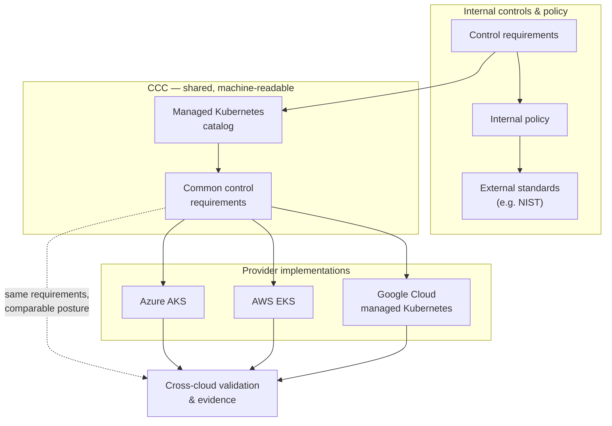

import ContentPage from '@site/src/components/ContentPage';
import YouTubeEmbed from '@site/src/components/YouTubeEmbed';
import PullQuote from '@site/src/components/PullQuote';

<ContentPage subtitle="User journey" title="Morgan Stanley: Consistent managed Kubernetes controls across clouds" toc={toc}>

Morgan Stanley's managed Kubernetes work highlights the value of consistent cloud controls across AWS, Azure and Google Cloud. FINOS Common Cloud Controls (CCC) provides shared, machine-readable requirements as a reusable foundation for cloud assurance. In his June 25, 2026 presentation, Dave Reeve outlined an approach for connecting those requirements to deployment patterns and evidence.

<YouTubeEmbed
  url="https://www.youtube.com/watch?v=NHvf31wJ2Ig"
  caption="Dave Reeve (Morgan Stanley) on FINOS Common Cloud Controls — presented Thursday, June 25, 2026"
/>

## A common approach across clouds

Reeve described how Morgan Stanley defined internal controls for cloud services and mapped them to internal policy and external standards. Engineers used those requirements to build services such as managed Kubernetes clusters. Connecting requirements directly to deployed systems helps teams:

* Validate deployments against common control requirements
* Build a clear chain of evidence from policy to implementation

His presentation brought together managed Kubernetes implementations across three cloud providers:

* Azure AKS
* AWS EKS
* Google Cloud managed Kubernetes

Common requirements provide a consistent basis for comparing security posture across these services and mapping each provider's features to control objectives.
That is why a shared, machine-readable catalogue matters in practice:

* **Faster reviews of a new cloud or provider** — one requirement set instead of three tables
* **Lower security risk** — fewer gaps when the same control is implemented differently on each cloud
* **Less duplicated engineering** — reusable mappings from policy to deployed systems
* **Clearer regulatory conversations** — evidence tied to industry standards such as NIST, not a pile of provider-specific checklists

<PullQuote attribution="— Dave Reeve, Morgan Stanley">
  If Morgan Stanley has this problem, I guarantee every other financial services organization is going to have exactly the same problem.
</PullQuote>

## Why Morgan Stanley is involved in CCC

Reeve wants common, machine-readable control requirements that can be linked to deployment patterns and validated against what is built. CCC is that shared language: a capability such as managed Kubernetes is described once, then mapped to each provider's service and to internal policy.

The following diagram illustrates the shared approach described in the presentation.

## What has landed

At the time of the June 25, 2026 presentation, Morgan Stanley had Terraform examples for managed Kubernetes on all three clouds. Reeve described plans to open source those examples and contribute the associated requirements to CCC, linking common, machine-readable controls to deployment patterns and validation.

Since the talk, three pieces of that journey are in FINOS:

**Requirements.** The [CCC managed Kubernetes catalog](/catalogs/orchestration/k8s) (`CCC.K8S`) publishes capabilities, threats and controls for AKS, EKS and GKE, with mappings to frameworks such as CRI and NIST. That is the shared table Reeve argued for.

**Azure implementation.** Yash Gandhi (Morgan Stanley) contributed a hardened AKS Terraform blueprint to [finos/ccc-managed-k8s](https://github.com/finos/ccc-managed-k8s) — a private, CCC-oriented cluster module under `aks/`. AKS is the first blueprint; EKS and GKE modules are still planned.

**Behavioural tests.** Managed Kubernetes behavioural tests in the [CCC repository](https://github.com/finos/common-cloud-controls) run against **AWS, Azure and GCP**. They check a live cluster against the controls — the chain of evidence from the talk, not a spreadsheet.

EKS and GKE *Terraform blueprints* are still to come. The catalog and the tests already cover all three clouds.

[Explore the CCC Kubernetes catalog](/catalogs/orchestration/k8s) to review published capabilities, threats and controls, and use them as a starting point for your organization's managed Kubernetes requirements.

*Source: [Morgan Stanley presentation on YouTube](https://www.youtube.com/watch?v=NHvf31wJ2Ig).*

</ContentPage>
