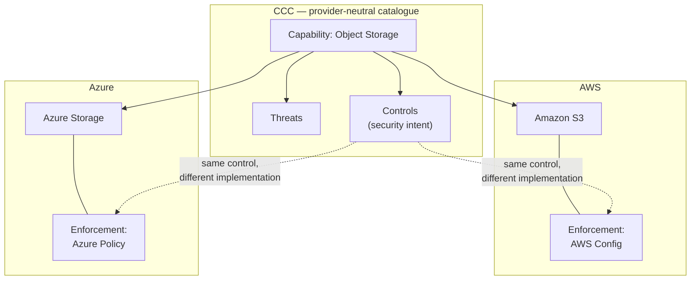

import ContentPage from '@site/src/components/ContentPage';
import YouTubeEmbed from '@site/src/components/YouTubeEmbed';
import PullQuote from '@site/src/components/PullQuote';

<ContentPage subtitle="User journey" title="RBC: A shared language for cloud security controls" toc={toc}>

Maxime Coquerel, a principal cloud security architect at RBC, described how the bank reviews cloud deployment patterns for production — and why FINOS Common Cloud Controls (CCC) is the provider-neutral catalogue in that process.

<YouTubeEmbed
  url="https://www.youtube.com/watch?v=rZZGisQBzcQ"
  caption="Eddie Knight (Revanite) and Maxime Coquerel (RBC) on FINOS Common Cloud Controls"
/>

## How RBC uses CCC in production

The team:

* Reviews individual cloud services and documents their threats, needed controls, and mappings to existing controls
* Works with application and platform teams on threat modelling
* Validates cloud controls
* Conducts penetration testing
* Feeds findings into a risk scorecard considered by a cloud governance board before production approval

CCC is the high-level, agnostic control catalogue in that loop. It keeps *security intent* stable while Azure Policy, AWS Config and other tools implement the same control differently on each cloud.

<PullQuote attribution="— Maxime Coquerel, Principal Cloud Security Architect, RBC">
  Sometimes we focus more on policy creation than on the control … When you have
  different implementations, you can have gaps... You need to have a framework on
  top of that to be sure all these gaps are covered. And that’s why … CCC will help
  us have a high-level, agnostic control catalogue.
</PullQuote>

## The problem it solves

Consistency is difficult across providers. An objective such as encryption in transit must be implemented through different mechanisms, including Azure Policy and AWS Config. Those differences can leave gaps when teams translate the same security intent into provider-specific policies.

In production review, that catalogue is valuable because it:

* **Reduces control gaps across providers** — and therefore security risk — by naming the control once
* **Speeds service reviews** — teams start from CCC capabilities, threats and controls instead of inventing every item from scratch
* **Gives the governance board control intent**, not a pile of provider policies
* **Keeps compliance language current** when regulation changes — CCC versions catalogues and records the version of each mapped external document

An object storage capability, for example, is described once for both Amazon S3 and Azure Storage, while the specific enforcement policy differs by provider. That is the distinction Coquerel drew between a security control and its implementation.

## The Goal

<PullQuote attribution="— Maxime Coquerel, Principal Cloud Security Architect, RBC">
  CCC is a cross-cloud shared language — you define your control in one language, and that is applicable for all your cloud providers.
</PullQuote>

He said that existing CCC catalogues could help a team begin a new service review without defining every capability, threat and control from scratch. 

His stated goal was a shared language that improves standardisation and compliance work across clouds. Keeping that language current with regulatory change depends on community contributions: CCC versions its catalogues and records the version of each external document used in a mapping, so users can identify mappings that may need reassessment after an update.

*Source: [RBC presentation on YouTube](https://www.youtube.com/watch?v=rZZGisQBzcQ).*

</ContentPage>
